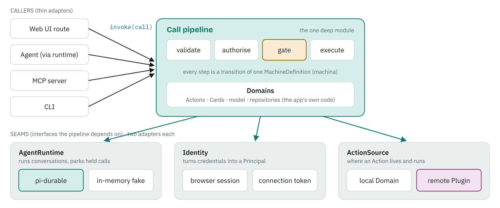
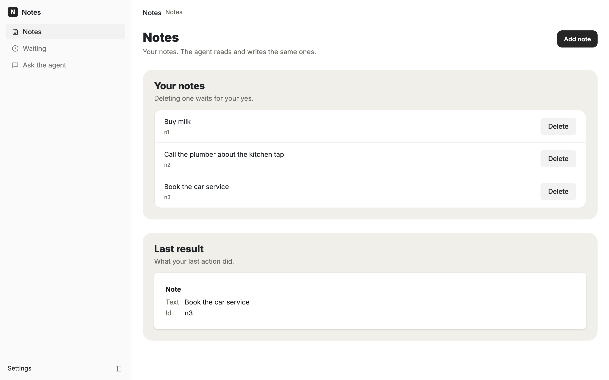
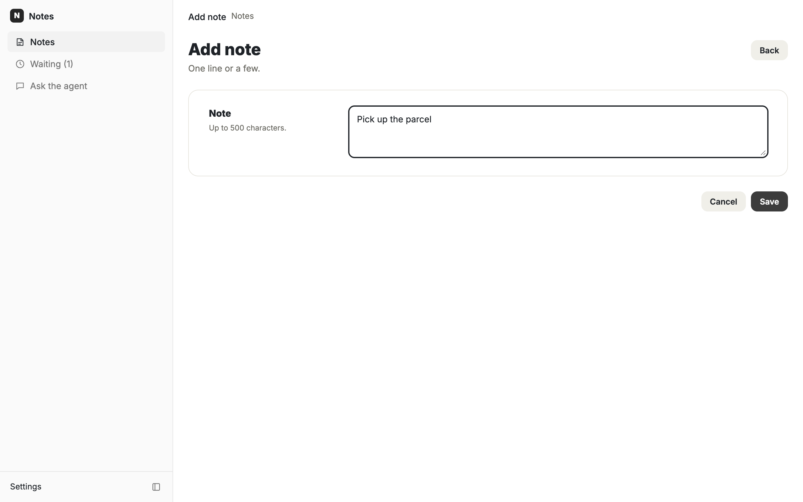

# open-agent-kit

A small kit for building standalone apps that each carry their own agent, and can be joined together over MCP.

Each app is one deployable with its own data, actions, cards, agent and MCP endpoint. Run one on its own, or connect several so that one app's agent can use another app's actions and show its cards.

> **Status: 0.2.** The seven layers below are built, each with its proof.

**[Read the interactive architecture page](https://jaetask.github.io/open-agent-kit/)** (source: [`docs/index.html`](docs/index.html))


## The idea

Every caller (the UI, the agent, another app, the CLI) reaches a Domain through one **Call pipeline**: validate, authorise, gate, execute. Everything else is an adapter around it.



- **Actions** are defined once and served to every caller.
- Each Action declares one **Effect**: `read`, `write` or `danger`. Parallelism, crash safety, approval and audit all follow from it.
- The agent runtime sits behind an interface, with pi-durable as the first adapter.
- Apps describe themselves to each other with a **Contract** over MCP, including **Cards** as plain JSON, so the same result looks the same in every app.

The words above are defined in the [glossary](GLOSSARY.md).

## How it is built

One layer at a time. A layer is done when its proof is committed and green:

1. Language and types
2. Call pipeline
3. Fake runtime and the runtime conformance suite
4. pi-durable adapter
5. MCP server and Contract
6. Cards
7. A first app

Proofs are expect tests: an input file per case with a human-approved `name.expect.md` beside it.

## Run the example

The notes example is a small App: notes, an agent that can use them, and a page. The page is built from [@jaetask/toolkit](https://github.com/jaetask/toolkit): the agent-native toolkit's ui parts in the suite's look, and its suite parts for the shell and page kit, with a sidebar of the App's pages, sections with one action each, and edit pages with labelled rows, Back, Cancel and Save.





```
npm install
npm run example
```

`npm run example` builds the page (`examples/notes/page`) into `examples/notes/public`, its CSS with Tailwind and its script with esbuild, then starts the App. `npm run lint` runs `toolkit-guard` on the page, which fails if it hand-builds a shell, section or edit page, uses a raw browser control, or uses a literal colour.

It runs at http://127.0.0.1:3120 and keeps its data in `data/`. At first start it prints a setup secret once: enter it on the page to sign in. The agent needs a model: set `KIT_MODEL` to `provider/model` with that provider's API key (as pi-ai reads it, for example `ANTHROPIC_API_KEY`), or point `KIT_OPENAI_BASE_URL` at an OpenAI-compatible server such as a local model server and set `KIT_MODEL=local/<model>`. Without one, the page still works and the chat says what is missing.

With Docker, from the repository root: `docker compose -f examples/notes/compose.yaml up --build`. `examples/notes/compose.pair.yaml` runs two Apps paired together.

## Configure a new App

[Configuring an App](docs/configuring-an-app.md) sets up a new App repository: CI on every branch, pull requests to main that merge themselves when `ci` passes, and no pushes to main.

## Install

```
npm i @jaetask/open-agent-kit
```

A git install (`npm i github:jaetask/open-agent-kit#<commit>`) builds the package on install.

Each new version is published to npm by the `publish` workflow through npm trusted publishing, so no npm token is stored.

The `/mcp` and `/app` entry points also need `@modelcontextprotocol/server` and `@modelcontextprotocol/client` 2.4.0; `/pi` needs `@earendil-works/pi-durable`, `pi-ai` and `chord` 1.5.2; `/claude` needs `@anthropic-ai/sdk` 1.14.0.

## Chat with Claude

`/claude` gives an App a chat per subject (an article, a note) with Claude over the Anthropic API. `claudeAgent` turns the App's Actions into tools; every tool call goes through the Call pipeline with caller `agent`. A `ChatStore` (`memoryChats`, or `sqliteChats` from `/sqlite`) keeps each subject's turns, the model history, and for every model call the model, effort, timing, tokens and cost. `task` runs a one-off model call, such as a grade, and records its cost against the subject. `CHAT_MODELS` holds each model's efforts and its price per million tokens from Anthropic's pricing page, and each request is shaped for the model it goes to; `spend` sums cost by subject, by model and since a date. `modelCatalogue` reads the models the key can use from the Anthropic Models API, keeps the list for a day and uses the built-in list when the API cannot be read.

## Develop

```
npm install
npm run typecheck
npm run lint
npm test
npm run expect
npm run build
```

Node 22.13 or later; the `/pi` entry point needs Node 22.19. `npm install` also turns on the git hooks in `.agents/guardrails/hooks`.

## Inspiration

- [pi-durable](https://github.com/earendil-works/pi): the durable agent loop.
- [agent-native](https://github.com/BuilderIO/agent-native): one action definition for every caller.
- Grokbot: one chat that reaches many apps.
- [Matt Pocock's skills](https://github.com/mattpocock/skills): deep modules, seams, adapters, and the glossary format.
- Domain-driven design: ubiquitous language and bounded contexts, applied loosely.
- [MCP](https://modelcontextprotocol.io): the protocol between apps.

## Software used

- [@earendil-works/pi-durable](https://github.com/earendil-works/pi) 1.5.2 (MIT), with pi-ai and chord: agent runtime, behind the `/pi` adapter; optional peer dependencies.
- [Anthropic TypeScript SDK](https://github.com/anthropics/anthropic-sdk-typescript) 1.14.0 (MIT): Claude, behind the `/claude` adapter; optional peer dependency.
- machina: state machines and their visualisers.
- [@jaetask/snap](https://github.com/jaetask/snap) (MIT): expect tests.
- [Model Context Protocol](https://modelcontextprotocol.io) TypeScript SDK 2.4.0 (`@modelcontextprotocol/server` and `/client`, Apache-2.0): app to app communication, behind the `/mcp` adapter; optional peer dependencies.
- [zod](https://zod.dev) (MIT): schemas.
- TypeScript.

## License

[MIT](LICENSE)
