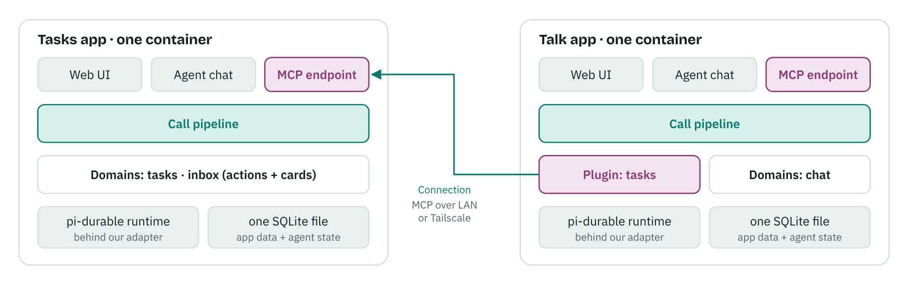

# open-agent-kit

A small kit for building standalone apps that each carry their own agent, and can be joined together over MCP.

Each app is one deployable with its own data, actions, cards, agent and MCP endpoint. Run one on its own, or connect several so that one app's agent can use another app's actions and show its cards.

> **Status: design stage.** The architecture is written down and the code is being added one layer at a time, each with its proof. Nothing here is ready to use yet.

**[Read the interactive architecture page](https://jaetask.github.io/open-agent-kit/)** (source: [`docs/index.html`](docs/index.html))



## The idea

Every caller (the UI, the agent, another app, the CLI) reaches a Domain through one **Call pipeline**: validate, authorise, gate, execute. Everything else is an adapter around it.


- **Actions** are defined once and served to every caller.
- Each Action declares one **Effect**: `read`, `write` or `danger`. Parallelism, crash safety, approval and audit all follow from it.
- The agent runtime sits behind an interface, with pi-durable as the first adapter.
- Apps describe themselves to each other with a **Contract** over MCP, including **Cards** as plain JSON, so the same result looks the same in every app.

The words above are defined in the [glossary](GLOSSARY.md).

## How it is built

One layer at a time. A layer is done when its proof is committed and green:

1. Language and types
2. Call pipeline
3. Fake runtime and the runtime conformance suite
4. pi-durable adapter
5. MCP server and Contract
6. Cards
7. A first app

Proofs are expect tests: an input file per case with a human-approved `name.expect.md` beside it.

## Install

Not published yet. It will be:

```
npm i @jaetask/open-agent-kit
```

## Develop

```
npm install
npm run typecheck
npm run lint
npm test
npm run expect
npm run build
```

Node 22 or later. `npm install` also turns on the git hooks in `.agents/guardrails/hooks`.

## Inspiration

- [pi-durable](https://github.com/earendil-works/pi): the durable agent loop.
- [agent-native](https://github.com/BuilderIO/agent-native): one action definition for every caller.
- Grokbot: one chat that reaches many apps.
- [Matt Pocock's skills](https://github.com/mattpocock/skills): deep modules, seams, adapters, and the glossary format.
- Domain-driven design: ubiquitous language and bounded contexts, applied loosely.
- [MCP](https://modelcontextprotocol.io): the protocol between apps.

## Software used

- [@earendil-works/pi-durable](https://github.com/earendil-works/pi) (MIT): agent runtime, behind an adapter.
- machina: state machines and their visualisers.
- [@jaetask/snap](https://github.com/jaetask/snap) (MIT): expect tests.
- [Model Context Protocol](https://modelcontextprotocol.io): app to app communication.
- [zod](https://zod.dev) (MIT): schemas.
- TypeScript.

## License

[MIT](LICENSE)
